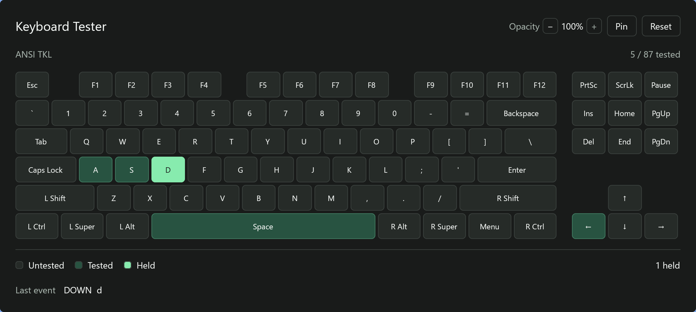

# Keyboard Tester

[简体中文](README.zh-CN.md)



A Linux keyboard tester built with Rust and GPUI. Supports Wayland and X11.

## Install on Arch Linux

Install the prebuilt x86_64 package from the [AUR](https://aur.archlinux.org/packages/keyboard-tester-bin):

```sh
yay -S keyboard-tester-bin
```

No Rust, Cargo, or mise is required. After installation, search for `Keyboard Tester` in your application launcher.

## AppImage

Download [`Keyboard_Tester-x86_64.AppImage`](https://github.com/aizigao/keyboard-tester/releases/download/v0.1.0/Keyboard_Tester-x86_64.AppImage) from GitHub Releases.

Run the x86_64 AppImage on a Linux desktop with glibc 2.39 or newer, a Vulkan driver, and the XCB (including XKB), xkbcommon (including X11 support), Fontconfig, and Wayland client libraries. Rust and Cargo are not needed to run it.

```sh
chmod +x Keyboard_Tester-x86_64.AppImage
./Keyboard_Tester-x86_64.AppImage
```

If FUSE is unavailable, add `--appimage-extract-and-run`. To package your own release binary, run `bash pkgbuild/appimage/build.sh /path/to/appimagetool-x86_64.AppImage /path/to/release/keyboard-tester` from the repository root. Build on the oldest distribution you intend to support; the AppImage uses the host libraries rather than bundling them.

## Run from source

You need a Linux desktop, a Vulkan driver, a C toolchain, `pkg-config`, XCB, xkbcommon with X11 support, and Fontconfig. The Rust version is pinned in `mise.toml`.

```sh
mise trust
mise install
mise exec -- cargo run --locked
```

Once built, you can run `./target/debug/keyboard-tester` directly. Keep `--locked` when building: the lockfile pins a version of the transitive `xattr` dependency that works with GPUI 0.2.2 on Linux.

### Build an Arch Linux package from source

Run these commands from the repository root. The package includes the binary, a desktop entry, and an icon. After installation, search for `Keyboard Tester` in your application launcher.

```sh
mkdir -p target
(cd pkgbuild && PKGDEST="$PWD/../target" BUILDDIR="$PWD/../target/makepkg" makepkg)
sudo pacman -U target/keyboard-tester-0.1.0-1-x86_64.pkg.tar.zst
```

Launching from the application menu detects keys only while the window has focus. To test while pinned and unfocused, launch the installed `keyboard-tester` from a terminal with `KEYBOARD_TESTER_DEVICE` set as described below.

## Test your keyboard

- With the window focused, held keys light up bright green. Released keys stay dark green to show that they were tested. You can hold multiple keys at once or hold a key to see repeat events.
- `Last event` shows the most recent key event. `Reset` starts a new test. Losing focus clears held keys in focused-only mode but keeps the tested marks. Test results are not saved to disk.
- Use the `Opacity` controls to change the window background opacity from 30% to 100% in 10-point steps. Keycaps and text remain opaque. The setting is shared between normal and pinned modes. Transparency on X11 requires a compositor.
- Left and right Ctrl, Shift, Alt, and Super are tracked separately. In focused-only mode, Caps Lock is detected by its toggle state; other keys are matched to the ANSI TKL layout by their logical key names. The numpad is not tracked separately, and non-US layouts may differ from the diagram.
- Media keys and Fn keys that do not send a separate event are not shown in the layout.

## Pin

`Pin` is available on Hyprland versions that support `hyprctl eval` (tested on 0.57.2). It shrinks the window, places it at the bottom right of the current monitor, and keeps it above other windows and visible across workspaces. `Unpin` restores the previous tiled or floating layout.

To keep testing while another app has focus, explicitly select one keyboard with `KEYBOARD_TESTER_DEVICE`:

```sh
ls /dev/input/by-id/*-event-kbd
KEYBOARD_TESTER_DEVICE=/dev/input/by-id/your-keyboard-event-kbd ./target/debug/keyboard-tester
```

The device must already be readable by your user. When the pinned window shows `Background input`, it is sampling the physical held-key state of that keyboard. It does not intercept input, read typed text, or record key order. Very short taps may be missed. Unpinning or exiting stops sampling. Without a device configured, the pinned window detects keys only when focused.

Run unit tests with `mise exec -- cargo test --locked`.
