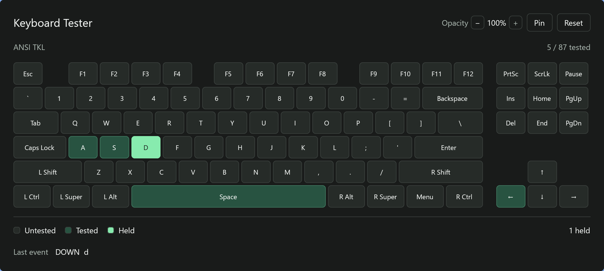

# Keyboard Tester

[English](README.md)



使用 Rust 和 GPUI 实现的 Linux 键盘测试工具。支持 Wayland 和 X11，仅做键盘测试。

## AppImage

x86_64 AppImage 需要 glibc 2.39 或更新版本，以及宿主机的 Vulkan 驱动、XCB（含 XKB）、xkbcommon（含 X11 支持）、Fontconfig 和 Wayland 客户端库。运行不需要 Rust 或 Cargo。

```sh
chmod +x Keyboard_Tester-x86_64.AppImage
./Keyboard_Tester-x86_64.AppImage
```

若系统没有 FUSE，启动时加上 `--appimage-extract-and-run`。自行打包时，在仓库根目录运行 `bash pkgbuild/appimage/build.sh /path/to/appimagetool-x86_64.AppImage /path/to/release/keyboard-tester`。请在计划支持的最旧发行版中编译，AppImage 使用宿主机的库。

## 运行

需要 Linux 桌面、Vulkan 驱动、C 工具链、`pkg-config`、xcb、xkbcommon（含 X11 支持）和 fontconfig。Rust 版本由 `mise.toml` 指定。

```sh
mise trust
mise install
mise exec -- cargo run --locked
```

已构建时，可直接执行 `./target/debug/keyboard-tester`。构建请保留 `--locked`：GPUI 0.2.2 的间接依赖 `xattr` 仍使用 libc 在 Linux 上移除的 `ENOATTR`，锁文件保留兼容版本。

### Arch Linux 安装包

在仓库根目录运行以下命令。包包含可执行文件、桌面启动项和图标；安装后可从应用菜单搜索「键盘测试器」或 `Keyboard Tester`。

```sh
mkdir -p target
(cd pkgbuild && PKGDEST="$PWD/../target" BUILDDIR="$PWD/../target/makepkg" makepkg)
sudo pacman -U target/keyboard-tester-0.1.0-1-x86_64.pkg.tar.zst
```

从应用菜单启动默认只在有焦点时检测。需要 Pin 后失焦检测时，在终端通过 `KEYBOARD_TESTER_DEVICE` 指定键盘，再运行已安装的 `keyboard-tester`。

## 测试键盘

- 窗口获得焦点后，按下键会亮绿，松开会保留深绿。可同时按住多个键，或长按观察重复事件。
- `Last event` 显示最近一次按键事件，`Reset` 开始新一轮测试。失焦会清除按住状态，但保留已测记录；所有状态只在内存中保存。
- 顶栏 `Opacity` 的 `−` / `+` 可将窗口背景的不透明度设为 30% 至 100%，每次调整 10%。键帽和文字不变；普通窗口与 Pin 模式共用当前设置。X11 需要启用桌面合成才能看到透明效果。
- 左右 Ctrl、Shift、Alt、Super 按物理键独立显示和计数；Caps Lock 按切换状态检测。其他键按逻辑键名匹配 ANSI TKL 示意图，小键盘不独立计数，非 US 布局可能与图示不同。
- 默认只在窗口获得焦点时检测。媒体键和不独立发送事件的 Fn 键不在示意图内。

## Pin

在支持 `hyprctl eval` 的 Hyprland（已验证 0.57.2）会显示 `Pin`。点击后窗口缩到所在屏幕的右下角并置顶，可跨工作区显示；点 `Unpin` 恢复原来的平铺或浮动布局。

要在 Pin 后切到其他应用仍能测试，通过 `KEYBOARD_TESTER_DEVICE` 显式指定一把键盘：

```sh
ls /dev/input/by-id/*-event-kbd
KEYBOARD_TESTER_DEVICE=/dev/input/by-id/你的键盘-event-kbd ./target/debug/keyboard-tester
```

设备须已对当前用户可读。Pin 后出现 `Background input` 即表示已开启，取消 Pin 或退出会停止读取。不拦截其他应用的输入，不读取输入文字或记录后台按键顺序；仅采样指定键盘的物理按住状态，极短的轻触可能漏检。未指定设备时，Pin 仍是仅在有焦点时检测。

运行单元测试：`mise exec -- cargo test --locked`。
